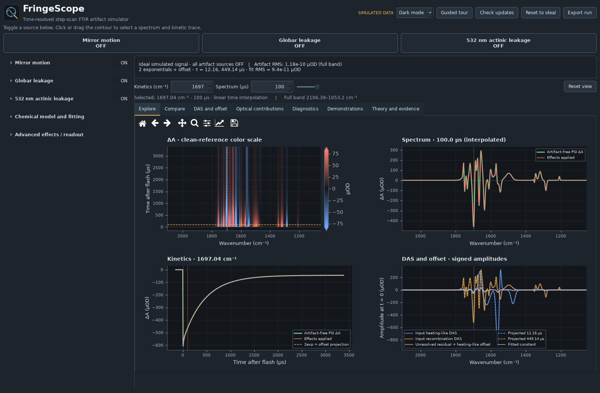
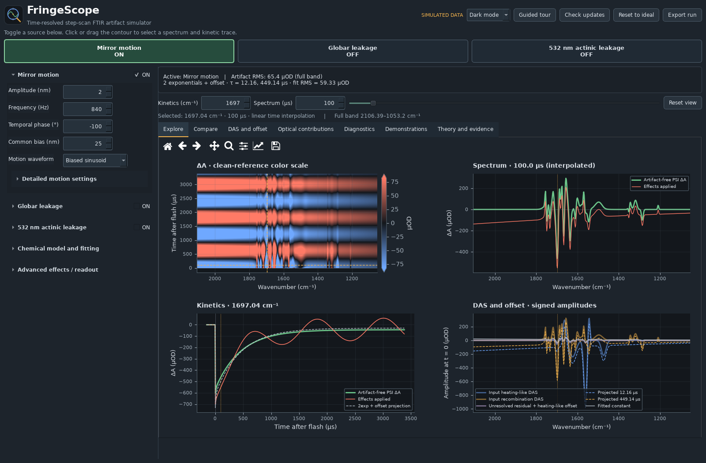

<p align="center"></p>

# FringeScope

**Time-resolved step-scan FTIR artifact simulator**

Explore how mirror motion, continuous out-of-band globar leakage and pulsed 532 nm actinic pickup change a synthetic difference spectrum. Linked contour, spectrum, kinetic and decay-associated spectrum views let you compare the ideal signal with selected artifacts. All displayed signals are simulated.



## Start here

The prepared version is **0.11.0**. This source tree is being reviewed for its initial release; no public release or DOI is asserted here.

Windows users can install the prepared `FringeScope-setup.exe` without administrator privileges. A standalone folder build is also available locally. Keep its `FringeScope.exe` and `_internal` folder together. See [installation and troubleshooting](INSTALLATION.md).

For source use, install Python 3.12 x64 and the pinned requirements in a new virtual environment, then run:

```powershell
py -3.12 -m venv .venv
& '.venv\Scripts\python.exe' -X utf8 -m pip install -r requirements-runtime-lock.txt
& '.venv\Scripts\python.exe' -X utf8 startup.py
```

The validation environment is recorded in [validation](VALIDATION.md). Other dependency combinations and operating systems have not been established by those checks. `pip install .` is not the supported installation route for this flat source layout.

## Explore an artifact

1. Begin with **Reset to ideal**, or select **Guided tour** to follow ideal → mirror → globar → actinic leakage.
2. Click a source button to turn it on. Click again to turn it off; its parameters are retained. Composite motion is an optional waveform within **Mirror motion**.
3. Click or drag on the contour to select a wavenumber and time. The default is 1697 cm⁻¹ and 100 µs. Displayed wavenumbers descend over the full sampled band, about 2106.39–1053.20 cm⁻¹.
4. Compare the spectrum, kinetics and signed DAS/offset. The time is bin-centered or explicitly labeled as interpolated. Use the prompt bin to inspect actinic pickup; the alias map itself is fixed by the OPD grid.
5. Export a new run folder to retain settings, grids, masks, spectra, fits and figures. [Tutorial](TUTORIAL.md) explains the controls and assumptions.



Dark appearance is the default; light appearance is available. Short desktop windows keep plots readable in a scrollable plot area. Web exports temporarily lock editing and wait for the committed calculation so figures and data share one state. Guided-tour exit restores any saved optimized fit exactly. Tooltips explain practical causes and the forward model. **Demonstrations** provides original synthetic lessons inspired by Rödig and Siebert's step-scan artifact experiments, with detector traces, artifact baselines, harmonics and coherent averaging.

## Scientific scope

The PSI-inspired difference signal has two bin-averaged exponential components and a causal non-decaying residual. It is an analytic approximation with declared archival influence and literature-guided thermal features; no measured spectral matrix or digitized literature curve is distributed. It is not a calibrated photochemical or temperature model.

Mirror motion changes OPD by twice the mirror displacement. The main engine uses a fourth-order displacement expansion with documented limits. Continuous leakage enters both reference and signal: it can dilute a genuine difference but does not create a flash transient in an unchanged stationary linear system. Optical-wavelength folding requires OPD-dependent coupling. Uniform bypass light has no optical fringe carrier. Electrical pickup, harmonics and return mismatch are optional sensitivity models. An illustrative 840 Hz oscillation, including its equality to 14 × 60 Hz, does not identify an experimental mechanism.

Read [theory and evidence](THEORY.md), the offline `THEORY.html` reading copy, [model assumptions](MODEL_ASSUMPTIONS.md) and [primary references](REFERENCES.bib). No smoothing, baseline subtraction or amplitude normalization is silently applied to the simulated ΔA. Nonpositive intensity reconstructions remain masked. Figures and text distinguish simulation, numerical checks, literature evidence and unverified apparatus assumptions.

## Reproduce and test

```powershell
& '.venv\Scripts\python.exe' -X utf8 -m pip install pytest
& '.venv\Scripts\python.exe' -X utf8 -m pytest -q tests
& '.venv\Scripts\python.exe' -X utf8 build_demos.py
& '.venv\Scripts\python.exe' -X utf8 hene_evidence.py
& '.venv\Scripts\python.exe' -X utf8 build_convergence.py
& '.venv\Scripts\python.exe' -X utf8 build_theory.py
```

Figure generators preserve numerical provenance. `build_convergence.py` re-renders bundled audit metrics; it does not independently rerun that audit. See [validation](VALIDATION.md) and [Windows build instructions](docs/BUILDING_WINDOWS.md).

## Citation, license and development

Cite **Michael Raymond Nelson, FringeScope, version 0.11.0**, with the repository URL and version used; [CITATION.cff](CITATION.cff) provides machine-readable metadata. Cite the relevant primary spectroscopy papers for scientific claims. No software DOI has been assigned in this preparation step.

Original FringeScope code, documentation and synthetic model inputs are under the [MIT license](LICENSE). Third-party components retain their own licenses; see [notices](THIRD_PARTY_NOTICES.md). No UFit code, proprietary font files or literature PDFs are included. See [contributing](CONTRIBUTING.md), [changelog](CHANGELOG.md) and [release notes](docs/RELEASE_NOTES_0.11.0.md).

## Browser edition

FringeScope Web runs the same `ftir_sim.py` in a phone, tablet or desktop browser through Pyodide (Python and NumPy/SciPy compiled to WebAssembly) in a background worker. No server or install is needed, and calculations stay on the device. It offers linked Explore views, the guided tour, the fixed demonstrations, a Wikipedia-style theory article generated from THEORY.md, and ZIP exports produced by the desktop export function. The Windows application remains the reference edition.

```powershell
& '.venv\Scripts\python.exe' -X utf8 web\build_web.py
& '.venv\Scripts\python.exe' -X utf8 -m http.server 8000 --directory web\site
```

Then open `http://localhost:8000/`. The first visit downloads about 20 MB of pinned runtime from jsDelivr. `validate.html` compares browser results with native desktop fixtures on your own device. See [web edition plan](WEB_EDITION_PLAN.md) and [web validation](docs/WEB_VALIDATION.md). The intended address is `https://Fisicas.github.io/FringeScope/`; the site is **not yet deployed**, and the manual Pages workflow has not been run. Zenodo integration and DOI registration are deferred.
