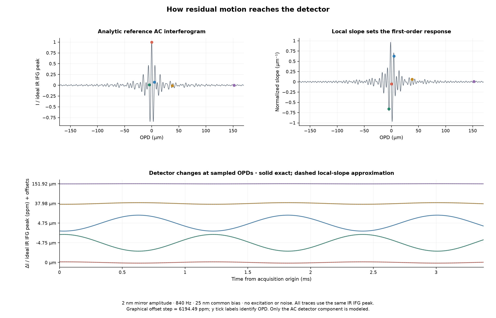
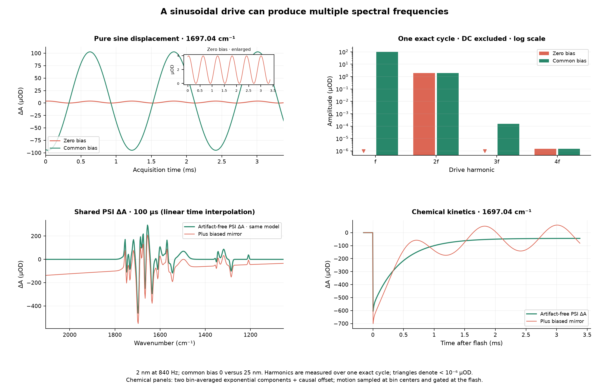
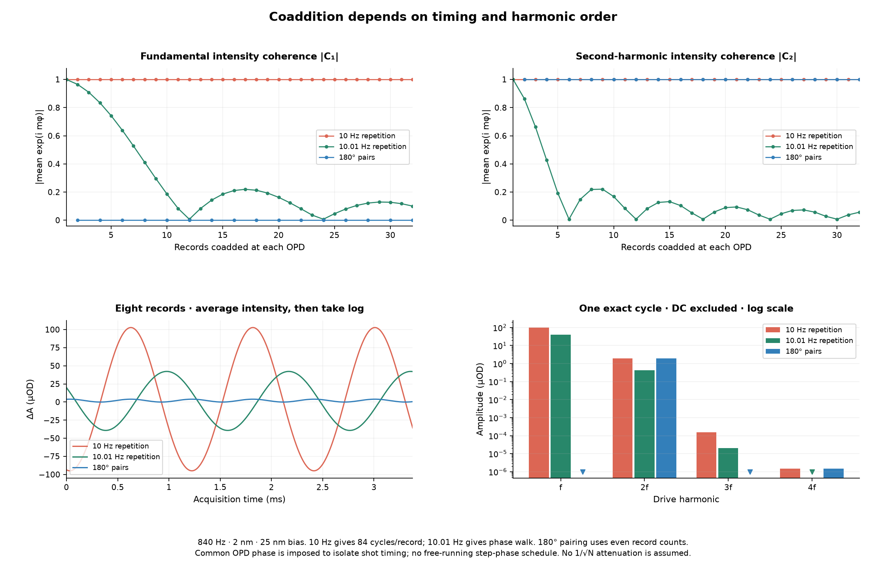
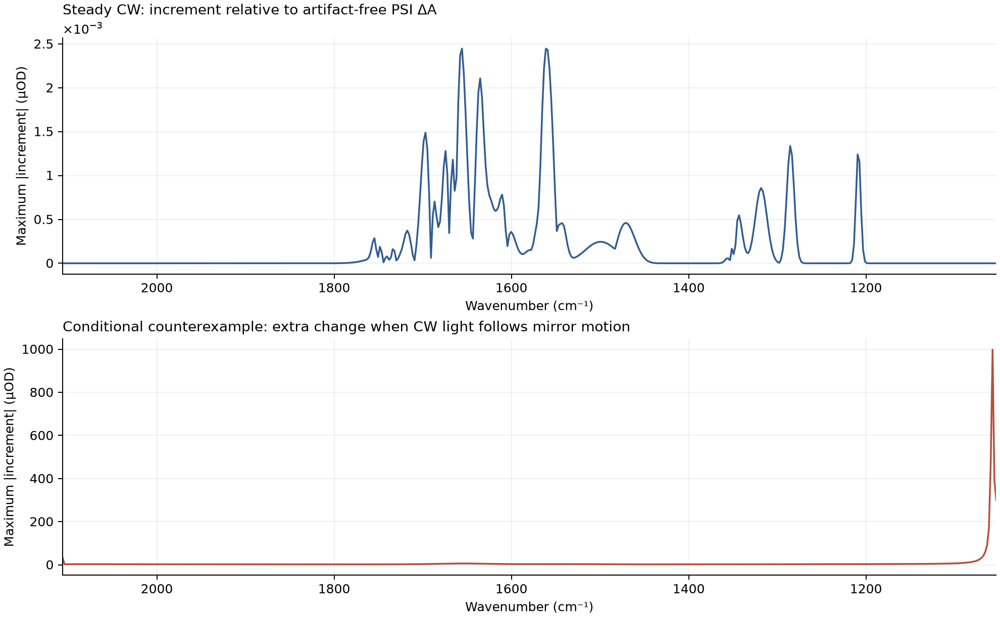
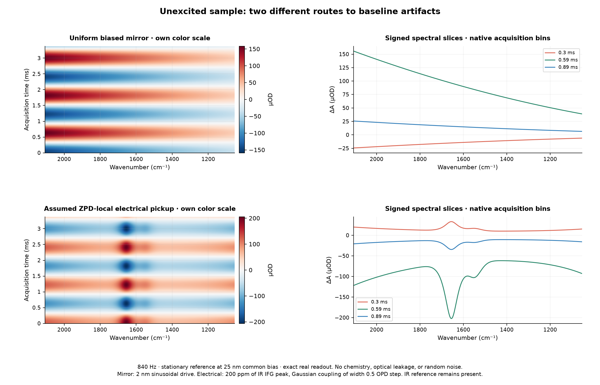
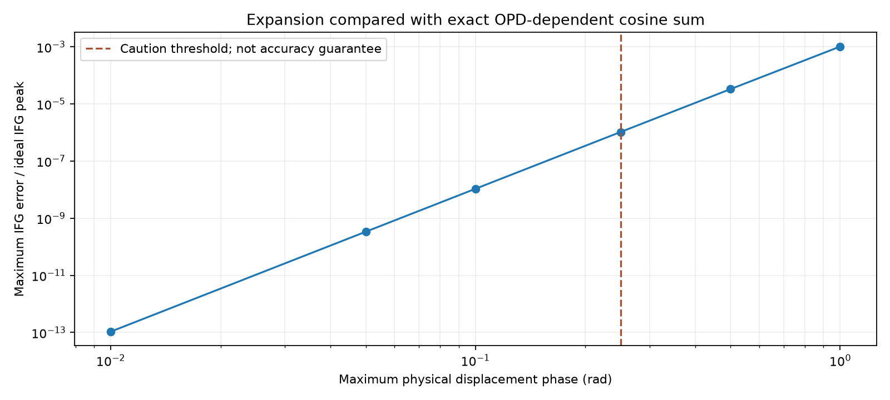

# FringeScope — theory and evidence

FringeScope is a forward simulator for time-resolved step-scan FTIR artifacts. It combines an analytic PSI-inspired difference signal with declared instrument disturbances. All displayed spectra and figures are simulated. Numerical consistency, literature precedent and instrument calibration are distinct kinds of evidence.

## Guided tutorial

Use **Guided tour** in the header to follow ideal → mirror → globar → actinic leakage. A tour panel states what changed and numbers the plots to inspect; Next and Back move between steps, and Finish or End tour restores the previous controls and selections. The tour temporarily uses declared default parameters. It does not change the synthetic dataset or theme. TUTORIAL.md contains the same sequence and an optional electrical/coaddition lesson.

- **Ideal:** inspect the 100 µs spectrum and 1697 cm⁻¹ kinetics. Reference and effects-applied curves overlap. Move to a late time to see the unresolved residual; its presence is part of the input model, not an artifact.
- **Mirror:** inspect the broad oscillation produced by a 2 nm, 840 Hz drive about a 25 nm common bias. Compare the input and projected DAS. Turn the source off/on to compare. Open Demonstrations → Mirror harmonics and PSI to distinguish mechanical frequency from spectral harmonics.
- **Globar:** the tour isolates continuous leakage. Compare Optical contributions with the ideal reference. A stable leak can dilute a real difference without creating a new transient from an unchanged sample.
- **Actinic:** the tour isolates an assumed OPD-modulated 532 nm return and selects the early 3 µs bin near its predicted alias. Its pulse is brief; the 100 µs spectrum would miss this prompt response. A direct bypass is a separate path with no wavelength-specific carrier.
- **Finish:** restore the original workspace. Optional: open Coaddition and phase to see why timing, rather than record count alone, controls coherent artifact suppression.

## The simulated PSI signal

Artifact-free PSI ΔA is a signed transient difference signal. Explore and Demonstrations use the same generator. S₀ is a separate positive single-beam intensity envelope used for reconstruction and ratio formation; it is not sample absorbance or a calibrated detector/filter response.

```math
\Delta A(\tilde{\nu},t)=\left[H(\tilde{\nu})e^{-t/\tau_{\mathrm{H}}}+R(\tilde{\nu})e^{-t/\tau_{\mathrm{R}}}+C(\tilde{\nu})\right]u(t)\tag{1}
```

H and R are heating-like and recombination-like amplitude spectra. C is a causal unresolved residual; u(t) is zero before excitation and unity afterwards. The model uses ordinary exponentials with displayed lifetimes τH = 12.16 µs and τR = 449.14 µs, with βH = βR = 1. These are illustrative source parameters, not newly measured lifetimes or uncertainty estimates. Calculations and exports retain their precision.

```math
\overline{\Delta A}(\tilde{\nu},t_i)=\frac{1}{\Delta t}\int_{t_i-\Delta t/2}^{t_i+\Delta t/2}\Delta A(\tilde{\nu},t)\,dt\tag{2}
```

Chemical bases are averaged over 6 µs recorder bins. Centers run from −153 to 3381 µs. The 100 µs spectrum is linearly interpolated between centers at 99 and 105 µs. Selection clicks snap to native channels/bins. Wavenumber remains descending, from about 2106.39 to 1053.20 cm⁻¹ across 513 channels. The acquisition origin and periodic 1024-point interferogram are model conventions, not a reconstruction of an OPUS experiment.

The recombination approximation has declared archival influence but contains no measured spectral matrix. H uses six Gaussian centers guided by [Nelson et al. (2026), §6.7/Figs. 7–9](https://doi.org/10.3390/mps9060158): 1662 positive, 1623 negative, 1561 negative, 1545 positive and 1473 negative cm⁻¹, plus a weak negative feature near 1699 cm⁻¹. Widths and amplitudes are chosen sensitivity settings; no published curve is digitized or fitted. The cited paper qualifies the heating assignment and does not calibrate this model's temperature rise.

C is defined as `C(ν) = 0.08 R(ν) + 0.04 H(ν)`. Those fractions are assumed, not measured yields or a determined slow state. H, R and C scale independently. Fitting a constant changes the analysis basis, not the input residual. Component functions retain a declared linear edge taper: zero outside 1120–1950 cm⁻¹ with 35 cm⁻¹ transitions. This is a chemical model boundary, not measured filter transmission. No smoothing, baseline correction or per-spectrum normalization is applied.

## Frequency, phase and spectral shape

At 840 Hz the period is 1.19 ms, giving about 2.84 cycles in 3.38 ms. Temporal phase shifts maxima without changing the period. An even response to displacement can produce 2f from a pure sine drive; common bias can restore a strong f term. Composite drive harmonics and nonlinear readout harmonics are different mechanisms.

```math
T=\frac{1}{f},\qquad N_{\mathrm{cycles}}=f\,T_{\mathrm{window}},\qquad \Delta t_{\phi}=\frac{\Delta\phi}{360^{\circ}f}\tag{3}
```

```math
\Delta A\simeq-\frac{\Delta S}{\ln(10)\,S_0}\qquad (|\Delta S|\ll S_0)\tag{4}
```

A broad additive intensity error may be amplified in absorbance where S₀ is small. That does not uniquely identify its cause. Uniform coherent mirror displacement in the ideal biased real-readout model instead has an approximately wavenumber-squared dependence at small phase. Adding temporal harmonics alone does not guarantee an inverse-transmission spectral shape. A short oscillatory record cannot uniquely identify mechanical modes or a mains source; 14 × 60 = 840 Hz is only an arithmetic coincidence.

## Mirror displacement and detector response

```math
I(x,t)=\int S(\tilde{\nu},t)\cos(2\pi\tilde{\nu}x)\,d\tilde{\nu}\tag{5}
```

```math
\delta x=2d,\qquad I(x+\delta x,t)\simeq\sum_{m=0}^{4}\frac{(\delta x)^m}{m!}\frac{\partial^m I(x,t)}{\partial x^m}\tag{6}
```

OPD x is in cm; mirror displacement d in nm changes OPD by 2d × 10⁻⁷ cm. The production engine uses a fourth-order expansion at the physical optical wavenumber with the odd-zone alias sign retained. Common bias affects both records; return mismatch and per-step jitter are differential errors. Constant ZPD registration error alone is not a temporal 840 Hz source. A step-scan mirror normally holds a position during a flash train, rather than returning to ZPD after every flash.

```math
\delta I(x,t)\simeq 2d(t)\,\frac{\partial I(x+2b)}{\partial x}\tag{7}
```

The reference interferogram's local slope controls the first-order detector change. At an unbiased symmetric ZPD that derivative vanishes, so higher orders matter. The lesson below evaluates an exact spatial cosine sum and displays the AC detector component, not unmodulated detector DC. Baseline time zero is an arbitrary acquisition origin, not a flash. All traces share one ideal IR IFG peak; stated vertical offsets are graphical only.



**Figure 1.** Original simulated OPD detector traces and their reference/slope. Solid traces use exact uniform displacement; dashed traces use the first-order local slope. There is no excitation or random noise. Parameters, units and offsets appear in the figure. Inspired by detector-position examples in [Rödig and Siebert (1999)](https://doi.org/10.1366/0003702991947595), not a reproduction of their data.

## Harmonics and coaddition

```math
\Delta A_b(t)=-\log_{10}\!\left[\frac{\cos\{\kappa[b+a\sin\theta(t)]\}}{\cos(\kappa b)}\right]\tag{8}
```

Here a and b are mirror amplitude and common bias in nm, θ is temporal drive phase and κ = 4πν × 10⁻⁷ cm nm⁻¹ with ν in cm⁻¹. The exact uniform fixed-real identity explains leading 2f at zero bias and a strong fundamental with bias. The stationary reference shares that bias. This is not the instrument's phase-correction algorithm.



**Figure 2.** Pure sine motion with zero/common bias, harmonic amplitudes over one exact cycle, and superposition on the shared PSI input. DC is excluded from harmonic bars; amplitudes below the indicated floor remain in numerical exports. The chemical panels retain bin-averaged chemical bases and flash-gated, bin-center motion. Their timing differs explicitly from the ungated baseline lesson.

```math
\Delta A_N=-\log_{10}\!\left[\frac{\frac{1}{N}\sum_{j=0}^{N-1}S_j}{S_{\mathrm{ref}}}\right]\tag{9}
```

```math
C_m=\frac{1}{N}\sum_{j=0}^{N-1}e^{im\phi_j},\qquad C_m^{(0,\pi)}=\frac{1+(-1)^m}{2}\tag{10}
```

Detector/intensity records are averaged before the logarithm. An ideal 0°/180° pair cancels odd intensity harmonics while retaining even ones. At 840 Hz and 10 Hz repetition, an exact integer 84 cycles between shots preserves coherence; 10.01 Hz gives phase walk. Cm describes intensity-harmonic transfer, not universal absorbance attenuation. Coherent OPD phase is imposed in this lesson to isolate shot timing; no free-running step-phase schedule or 1/√N suppression is assumed.



**Figure 3.** Original timing/coaddition lesson with eight-record traces and harmonic bars. The source paper discusses doubled-frequency survival under phase-correlated averaging on pp. 897–898. The plotted case is nonlinear mirror response: a purely linear additive electrical sine would cancel under ideal pairing and needs an even-harmonic/nonlinear contribution to show survival.

## Optical folding and pulsed pickup

```math
F_s=\frac{1}{\Delta x}=2B,\qquad \tilde{\nu}\in[B,2B]\tag{11}
```

```math
q(\tilde{\nu})=\left|\left[(\tilde{\nu}+B)\;\mathrm{mod}\;2B\right]-B\right|,\qquad \tilde{\nu}_{\mathrm{display}}=2B-q\tag{12}
```

Spatial sampling, not nanosecond pulse width, sets the optical alias. For this selected odd-zone grid B ≈ 1053.20 cm⁻¹ and OPD step ≈ 4.75 µm, nominal 532 nm OPD-modulated light maps to about 1945.86 cm⁻¹. Directly sampled fringe checks support the identity; these values are not measured metrology or detector-response calibration. A uniform direct bypass has no optical carrier; an assumed step-dependent bypass has the spectrum of its coupling pattern.

The optical pulse model is a nominal 6 ns Gaussian plus an assumed 20 ns delay tail, convolved with a first-order detector response and integrated over recorder bins. A 20 ns free-space delay corresponds to about 6 m additional path; short reflections do not automatically justify it. A Gaussian centered at zero places some area before zero, including the bin centered at −3 µs. Electronic recovery is a separate assumed response. Pulse-area settings are detector-equivalent quantities, not calibrated laser fluence.

## Continuous leakage and electrical pickup

```math
\Delta A_{\mathrm{obs}}=-\log_{10}\!\left[\frac{S_0\,10^{-\Delta A_{\mathrm{true}}}+L}{S_0+L}\right]\tag{13}
```

```math
\Delta A_{\mathrm{true}}=0\quad\Longrightarrow\quad\Delta A_{\mathrm{obs}}=-\log_{10}\!\left(\frac{S_0+L_{\mathrm{CW}}}{S_0+L_{\mathrm{CW}}}\right)=0\tag{14}
```

```math
\Delta A_{\mathrm{obs}}\simeq\frac{S_0}{S_0+L_{\mathrm{CW}}}\,\Delta A_{\mathrm{true}}\tag{15}
```

Stable positive leakage L enters reference and signal, diluting a small real difference while canceling for an unchanged sample. Globar leakage uses Planck radiance per wavenumber, an assumed Gaussian transmission leak and flat responsivity. Changing leakage, saturation and calibrated shot noise are not inferred from this steady model. HeNe is not a primary control; its internal comparison demonstrates stationary cancellation and a conditional mirror-coupled exception, not harmlessness in the real instrument.



**Figure 4.** Original steady-CW comparison and conditional motion counterexample, on separately labeled scales. The nominal wavelength, assumed coupling and fixed bias/motion are recorded in the source metrics. No spectra are normalized or smoothed. Visible response and actual optical path remain unmeasured.

Electrical pickup is an additive detector term with an explicit spatial coupling. The example below assumes Gaussian coupling near ZPD; a uniform coupling would transform differently. The IR reference remains positive. A blocked/zero reference cannot define an absorbance ratio, even though IR-blocked detector controls are useful experimentally.



**Figure 5.** Original unexcited mirror/electrical maps and native-time slices. Each map has its own labeled signed scale. Acquisition zero is an arbitrary oscillator origin. The paper's imposed ±4 nm at 50 Hz differs from these illustrative 2 nm/840 Hz settings. Similar-looking oscillations do not establish identical mechanisms.

## Numerical domain and evidentiary limits

The displacement audit compares the fourth-order engine with an independent physical-wavenumber cosine sum at OPD-dependent shifts. In the tested spectrum/pattern, maximum spectral discrepancy is about 0.03 µOD at 0.10 rad, 2.86 µOD at 0.25 rad and 87.32 µOD at 0.50 rad. The 0.25 rad warning is a caution threshold, not an accuracy guarantee or a uniform bound for all settings. Low transmission and higher physical optical frequencies require separate checks.



**Figure 6.** Original convergence audit for a specified OPD-dependent displacement pattern. The statistic is maximum interferogram discrepancy divided by ideal IFG peak; it is not a measurement uncertainty. Full settings, source hashes and numerical arrays are recorded by the audit script.

Motion/electrical terms are evaluated at recorder-bin centers. A pure 840 Hz sine loses about 0.004% amplitude under a 6 µs box average; the difference grows at higher frequencies and does not bound nonlinear motion/chemical products. Independent quadrature checks the pulse PDF against CDF bins for selected cases; agreement validates implementation consistency, not the assumed physical response.

The full mathematical FFT band is approximately 2106.39–1053.20 cm⁻¹. Makita's dissertation reports an acquired range approximately 2106.39–1065.54 cm⁻¹; these are not identical grids. The periodic phase-zero reconstruction does not reproduce an original single-sided acquisition, instrument line shape or OPUS phase algorithm. Nominal visible wavelengths require consistent air/vacuum and metrology conventions.

## Literature and assumptions

- **Rödig and Siebert (1999), pp. 895–899:** primary evidence for mirror/electrical artifacts and averaging dependence. Their experiments do not identify this simulator's 840 Hz source. [DOI](https://doi.org/10.1366/0003702991947595).
- **Makita (2018), printed p. 29/PDF p. 76:** describes folding precautions, two 2000–1000 cm⁻¹ filters and CaF₂ windows. These are reported apparatus precautions, not measured zero-leakage transfer curves. [Institutional record](https://scholarworks.gsu.edu/phy_astr_diss/106).
- **Makita and Hastings (2016), pp. 1467–1468:** describes filter placement. [DOI](https://doi.org/10.1016/j.dib.2016.04.031).
- **Nelson et al. (2026), §6.6–6.8/Figs. 7–9:** supports conditional PSI heating-like features and the need to qualify unresolved slow components. The present two-plain-exponential-plus-offset model is different from that published fit. [DOI](https://doi.org/10.3390/mps9060158).
- **Manning and Griffiths (1997):** abstract-level support for low-frequency fluctuations/noise; no inaccessible full-text quantitative parameters are used. [DOI](https://doi.org/10.1366/0003702971941755).

Absolute amplitudes, thermal fractions, actual detector/filter response and the disturbance mechanism remain assumptions or unmeasured quantities. Synchronized position-error records, raw interferograms, IR/laser-blocked controls and timing/coaddition tests are needed for instrument-specific discrimination. Numerical fits, spectral similarity and inverse-transmission enhancement alone do not identify a cause.

## Fitting, exports and reading

Ordinary updates project an unweighted fixed kinetic basis. Refit optimizes log lifetimes with signed amplitudes and β = 1; the default optimization region is 0–3378 µs and 1200–1900 cm⁻¹. Bound hits and unresolved lifetimes are flagged. Optimizer success does not establish a physical assignment, SEM or confidence interval. Artifact-biased DAS are projected components, not necessarily molecular spectra.

References below 1% maximum and nonpositive reconstructed intensities are masked, never floored into absorbance. Full grids/masks remain in NPZ; DPT retains channels finite at every time and records exclusions/units. New export folders contain exact settings and synthetic parameters. Publication figures stay light; screen captures record the selected appearance. Dark/light selection does not change numerical data.

The offline reader defaults to dark, uses the available width, and retains proper indices/powers. Image paragraphs use single spacing so captions follow figures; text size is adjustable. Demonstrations use fixed acquisitions independent of workspace toggles. Their source scripts reproduce the released synthetic figures without measured arrays.
